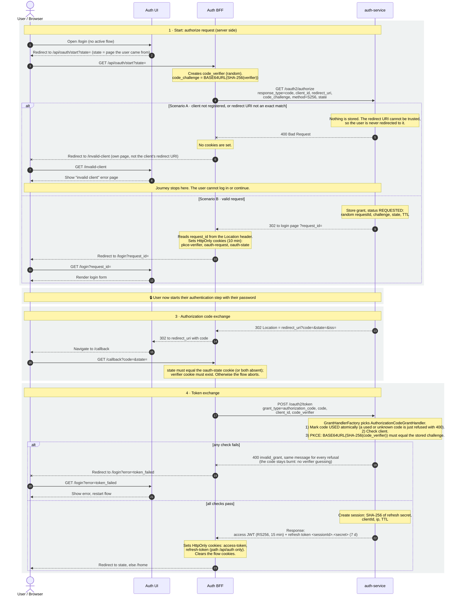

# OAuth 2.1 PKCE Flow

Authorization code with PKCE for the public client in DEMO-UI. The backend (auth-service) is the authorization server; the browser only carries redirects, and every call to the backend is made by the Auth BFF (the DEMO-UI server). The Auth UI only renders pages and talks to the BFF.

## Rules the flow enforces

- PKCE is `S256` only; `plain` is not accepted. The verifier never leaves the HttpOnly cookie and the Auth BFF.
- Redirect URIs are matched exactly. An unregistered client or URI gets a 400 from auth-service and is never redirected to; the Auth BFF sends the user to its own `/invalid-client` page.
- `state` and `iss` (RFC 9207) are echoed unchanged on every redirect to the client, success and error.
- The authorization code is single use and lives 60 seconds. It is marked used before anything else is checked, so a wrong verifier cannot be retried.
- New grant types need only a new `GrantHandler` service.
